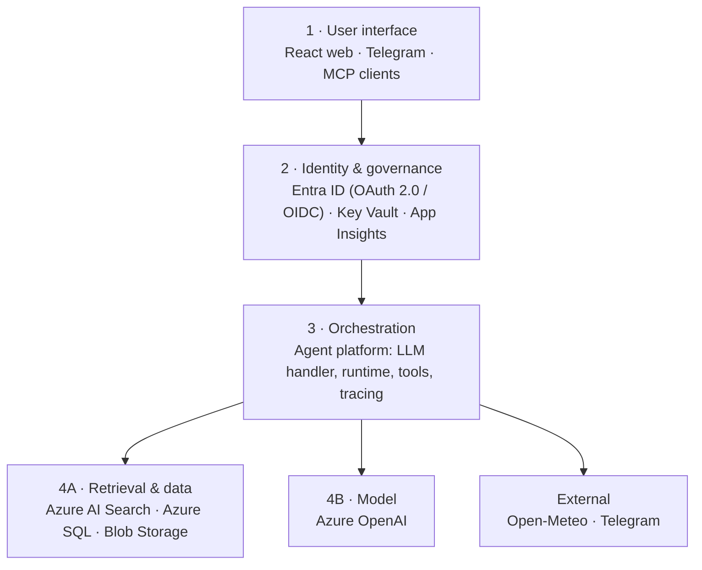

# Kuntoilijan apuri

> AI agent that analyses your runs against your goal and tells you what to focus on next.
> A learning and portfolio project in AI architecture on Azure, from database to user interface.

**Status:** 🚧 Phase 0 – foundations

<!-- Add when deployed -->
**Demo:** _coming soon_ · **Architecture:** [docs/architecture.md](docs/architecture.md)

## What it does

1. You set a goal (e.g. a marathon on a given date).
2. You upload a run (FIT/GPX) or use the demo data.
3. The agent asks how the run felt, fetches the weather and your recent training load.
4. You get an analysis: overview, per-metric details and a recommendation for your next run.

## Architecture at a glance

Key design principle: **the LLM does not calculate.** Training load, pace zones and comparisons are
computed deterministically in code; the LLM interprets, asks and explains.

## Tech stack

| Layer | Choice |
| --- | --- |
| Frontend | React, Vite, TypeScript · Azure Static Web Apps |
| Backend | Python 3.12, FastAPI · Azure Container Apps |
| Agent | Own agent platform + Semantic Kernel / OpenAI SDK |
| Model | Azure OpenAI |
| Retrieval | Azure AI Search |
| Data | Azure SQL Database, Blob Storage |
| Identity | Microsoft Entra ID |
| Ops | Bicep, GitHub Actions, Application Insights |

## Documentation

- [Architecture](docs/architecture.md)
- [Agent platform](docs/platform.md)
- [Architecture decisions (ADRs)](docs/adr/)
- [How this was built (with a coding agent)](docs/how-this-was-built.md)

## Roadmap

- [ ] Phase 0 – Foundations
- [ ] Phase 1 – Data layer
- [ ] Phase 2 – Retrieval (RAG)
- [ ] Phase 3A – Agent platform
- [ ] Phase 3B – Running agent
- [ ] Phase 4 – API and authentication
- [ ] Phase 5 – User interface
- [ ] Phase 6 – Channels (Telegram, MCP server)
- [ ] Phase 7 – Security and governance
- [ ] Phase 8 – Evals and CI/CD
- [ ] Phase 9 – Polish and demo

## Getting started

_Added in Phase 1._
